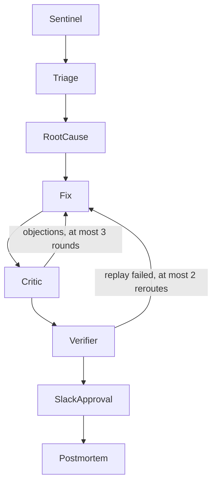

# MERIDIAN

MERIDIAN is being built to detect data-quality failures, explain them, propose a fix, verify that fix against the failing data, and ask a human in Slack before anything merges. The path is a fixed LangGraph state machine. The goal is to shorten the time from incident to a verified, approved fix.

This repository has the Phase 0 contracts and CI, and the Phase 1 data contracts and incident injector. The agent graph, Ray replay, and Slack gate are planned. Nothing here calls a model, Ray, or Slack.

## Target agent graph

The diagram is the target architecture. The nodes are not implemented.



| Node | Planned role |
| --- | --- |
| Sentinel | Run pandera contracts over partitions on Ray and emit an `Incident`. |
| Triage | Claude assigns severity and blast radius. |
| RootCause | Claude, with MCP tools, writes a `Hypothesis` and evidence. |
| Fix | Claude writes a `Patch` and a regression test. |
| Critic | Grok reviews the patch and returns a `Verdict`. |
| Verifier | Ray replays the failing data. Pass/fail is deterministic. |
| SlackApproval | LangGraph interrupt. A human approves, rejects, or the request times out. |
| Postmortem | Write the incident report. |

Loop limits, already enforced on `MeridianState`: Fix and Critic stop after 3 rounds. A failed verification may send the work back to Fix at most twice (3 Fix executions total), then the run escalates to a human.

## Phases

| Phase | Scope | Status |
| --- | --- | --- |
| 0 | Repository, ADRs, Pydantic contracts, CI | done |
| 1 | Pandera contracts and an incident injector | in progress |
| 2 | Graph skeleton: Sentinel to Triage | planned |
| 3 | RootCause agent with MCP tools | planned |
| 4 | Fix, Critic, and Verifier loop on Ray | planned |
| 5 | Slack approval gate and Postmortem | planned |
| 6 | MERIDIAN-Bench harness and published results | planned |
| 7 | OpenTelemetry, cost tracking, Docker Compose demo | planned |

## What is in this tree

- `src/meridian/contracts/` — frozen Pydantic models, including `InjectedFault` and `PartitionMetadata`.
- `src/meridian/pipeline/` — seeded generators for the three fleet datasets, plus `lineage.yaml`.
- `src/meridian/quality/` — pandera models, PSI, the freshness SLA, and `evaluate`, which returns `Incident` records.
- `src/meridian/injector/` — one injector per fault type, and the `python -m meridian.injector` CLI.
- `src/meridian/config.py` — settings loaded from the environment and `.env`. Missing keys do not crash import. `Settings.require_llm()` and `Settings.require_slack()` raise when a caller actually needs those credentials.
- `schemas/` — JSON Schema generated from the contracts.
- `docs/adr/` — ADR-001 through ADR-009.
- `.github/workflows/ci.yml` — the checks below.

Generated Parquet under `data/` is gitignored.

## Fault catalog

| Fault | How it is injected | Check that catches it |
| --- | --- | --- |
| `SCHEMA_DRIFT` | Intensity below 0.1 retypes the first key column, below 0.5 renames it, and 0.5 and above drops it. | Column presence and dtype (`column_in_dataframe`, `column_in_schema`, `wrong_dtype`). |
| `NULL_EXPLOSION` | Nulls that fraction of a non-nullable, non-key column. | `not_nullable`. |
| `UNIT_MISMATCH` | Multiplies that fraction of rows by 3.6 on m/s columns, or by 1000 on kilometres. | Range checks, and `speed_matches_distance` on trips. |
| `DUPLICATE_KEYS` | Appends copies of that fraction of rows, repeating the primary key. | `multiple_fields_uniqueness`. |
| `LATE_PARTITION` | Leaves the frame unchanged and moves arrival past the 2 hour SLA. The offset grows with intensity and is always late. | `partition_arrival_sla` on `PartitionMetadata`. |
| `DISTRIBUTION_SHIFT` | Power-warps the PSI column inside its generating range (`u ** (1 + 100 * intensity)`). On trips, distance is recomputed so the speed identity still holds. Legal ranges still hold. | PSI against the stored quantile profile, threshold 0.2. |

## Quickstart

Requires Python 3.11+ and [uv](https://docs.astral.sh/uv/).

```bash
uv sync
uv run ruff check .
uv run ruff format --check .
uv run mypy --strict src
uv run pytest --cov=src/meridian --cov-fail-under=95 -q
uv run python scripts/export_schemas.py && git diff --exit-code schemas/
uv run python -m meridian.injector --dataset vehicle_telemetry --fault DISTRIBUTION_SHIFT --intensity 0.3 --seed 42 --out data/
```

Copy `.env.example` to `.env` only when a later phase needs credentials. Phase 0 tests do not call external services.

## License

Apache-2.0. Copyright 2026 MERIDIAN contributors.
