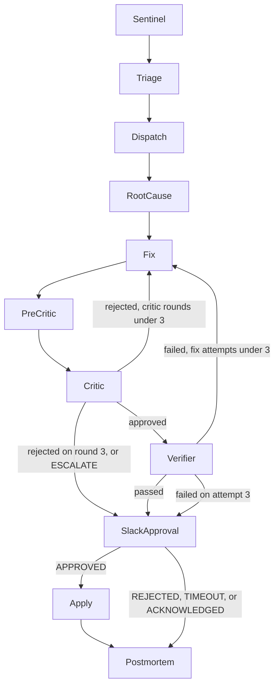

# MERIDIAN

[](https://github.com/hamidmatiny/MERIDIAN/actions/workflows/ci.yml)

MERIDIAN detects a data-quality failure, names a cause, proposes a patch, and checks that patch by replaying the failing partition. A human approves in Slack, or at the terminal in the demo, before anything is applied. The path is a fixed LangGraph state machine. The published bench numbers below are copied from the summary files, and the free tier is the default.

## Architecture

Sentinel fans out one case per incident. Fix and Critic may loop three times. A failed verification returns to Fix until three fix attempts, then the case escalates. The verifier is deterministic. The Slack gate interrupts the graph. Nothing is applied until an allowed person approves.



| Node | Role |
| --- | --- |
| Sentinel | Run pandera contracts over partitions on Ray and emit an `Incident`. |
| Triage | Assign severity and blast radius. |
| RootCause | Read lineage, partitions, and history, then write a `Hypothesis` with evidence. |
| Fix | Write a `Patch`: `DATA_REPAIR`, `QUARANTINE`, `RERUN_UPSTREAM`, or `ESCALATE`, plus a regression check. |
| Critic | Review the patch. Three rejections escalate. |
| Verifier | Replay the partition in a sandbox. Pass and fail do not use a label. |
| SlackApproval | LangGraph interrupt. A human approves, rejects, or the request times out. |
| Postmortem | Write the incident report. |

## Try it in 90 seconds

No Slack workspace, no Ollama, and no API key.

```bash
uv sync
uv run python -m meridian.demo
```

The first line is `fake models: demonstrates the pipeline, not model quality`. The demo injects `UNIT_MISMATCH` and `NULL_EXPLOSION`, runs the graph, and asks `approve` or `reject` in the terminal for each case. A non-interactive shell answers `approve`. A verified patch is then labeled `APPROVED (applied)`. A case the gate escalated has no patch to apply: `approve` records an acknowledgement, and the case is labeled `ESCALATED (acknowledged, nothing applied)`. Applied patches and the postmortems land under `data/demo/`.

`make demo`, `make test`, `make bench-dev`, and `make verify-audit` wrap the same commands.

```bash
docker compose up -d
docker compose logs meridian
```

Open the Jaeger UI at [http://localhost:16686](http://localhost:16686) and look for the `meridian` service. Postgres holds the audit chain for that run. Live mode, when you choose it, reaches Ollama on the host at `http://host.docker.internal:11434`. Ollama itself is not containerized on macOS. The container sets `MERIDIAN_SANDBOX_RLIMIT=0`, which turns the Linux address-space cap off for the demo. macOS does not apply that cap.

## Results

This is a synthetic benchmark.

Numbers below are copied from `bench/results/test-fix-v2-clean/summary.json`. The full write-up is [bench/results/test-fix-v2-clean/REPORT.md](bench/results/test-fix-v2-clean/REPORT.md).

The earlier run in [bench/results/test-fix-v2/REPORT.md](bench/results/test-fix-v2/REPORT.md) is a dirty-tree run, superseded.

Results committed in `7e7f9f5`.
Recorded at commit `c56af95d45cedb380a803d820a5d2dd4058fc422`.
Models: critic `gemma4:12b`, fix `qwen3.5:27b-q4_K_M`, root_cause `qwen3.5:27b-q4_K_M`, triage `qwen3.5:27b-q4_K_M`.

| metric | value |
| --- | --- |
| detection recall | 72/72 |
| hard-mode FP rate | 0/30 |
| raw causal accuracy | 71/72 |
| guarded causal accuracy | 71/72 |
| kind_appropriate | 68/72 |
| verified | 27/72 |
| false-fix rate | 0/27 |
| escalation rate | 17/72 |
| critic confusion matrix | approved 33/16; rejected 1/9 |
| machine time p50 | 288 s |
| machine time p95 | 499 s |
| USD per run | 0.0 |

Hard-mode FP is copied from `bench/results/hard-clean/summary.json` at commit `7e7f9f5e80eb1a0ebf779b6bc815be7a52b40afa`.

## Outcome breakdown

- VERIFIED_AWAITING_APPROVAL: 27
- AGENT_ESCALATED: 17
- CRITIC_LIMIT: 2
- FIX_ATTEMPT_LIMIT: 26
- WALL_BUDGET: 0
- NO_PATCH: 0
- OTHER: 0
- sum: 72

- bad-patch catch rate: 9/25
- approval precision: 33/49
Safety comes from the deterministic verifier: 16 bad patches approved by the LLM critic were blocked before reaching a human.

causal accuracy reflects an easy evidence world
- evidence distribution: `{'1': 48, '2': 24}`
- exactly one candidate: 48/72

Dev versus test, from the comparisons stored on the test summary:

| metric | dev-fix-v1 | dev-fix-v2 | test-fix-v2-clean |
| --- | --- | --- | --- |
| detection_recall | 6/6 | 6/6 | 72/72 |
| raw_causal_correct | 6/6 | 6/6 | 71/72 |
| causal_event_correct | 6/6 | 6/6 | 71/72 |
| kind_appropriate | 3/6 | 6/6 | 68/72 |
| verified | 4/6 | 3/6 | 27/72 |
| false_fix | 0/4 | 0/3 | 0/27 |
| escalation | 2/6 | 1/6 | 17/72 |
| machine_time_p50 | 241.808319 | 301.392669 | 288.367448 |
| machine_time_p95 | 317.57882 | 412.32216 | 498.95234 |
| usd_per_run | 0.0 | 0.0 | 0.0 |

## Limitations

- synthetic benchmark
- easy evidence world (48/72 single candidate)
- FIX_ATTEMPT_LIMIT is the dominant failure (26/72)
- local models only
- sandbox limits on macOS

The test-split numbers were recorded at commit `c56af95d45cedb380a803d820a5d2dd4058fc422` and are stored in `bench/results/test-fix-v2-clean/summary.json`. `LOCK.json` for the hard split records `dirty: false`.

## Live setup

Copy `.env.example` to `.env`.

Ollama is the free-tier default. `OLLAMA_BASE_URL` defaults to `http://localhost:11434`. Inside Compose, point it at `http://host.docker.internal:11434`. The pinned local models are `qwen3.5:27b-q4_K_M` for triage, root cause, and fix, and `gemma4:12b` for the critic.

OmniRoute is optional. It is a local proxy in front of a free remote model. Leave it unset and the run stays on Ollama.

Slack: create an app, invite the bot to the approval channel, and set `SLACK_BOT_TOKEN`, `SLACK_APP_TOKEN`, and `MERIDIAN_SLACK_APPROVERS`. Bot scopes: `chat:write`, `channels:read`, `users:read`, `files:write`, `app_mentions:read`. Subscribe to `app_mention`. Socket Mode and Interactivity must be on. Mention the bot by its user id. `python -m meridian.slack_app` runs the socket and the worker. `python -m meridian.run --slack` posts the request and returns.

```bash
uv run python -m meridian.run --dataset vehicle_telemetry --fault SCHEMA_DRIFT --intensity 0.3 --seed 42 --fake-llm
uv run python -m meridian.audit verify
uv run python -m meridian.spend
```

## Cost

The published runs cost $0.00. That is the free tier: local Ollama, or a free remote model through OmniRoute. Paid providers run only when `MERIDIAN_ALLOW_PAID=1` and a USD cap is set. The example caps are `MERIDIAN_MAX_USD_PER_RUN=0.25` and `MERIDIAN_MAX_USD_PER_DAY=1.00`. A billing, auth, or quota error stops the run. `python -m meridian.spend` prints the paid total.

## Phases

| Phase | Scope | Status |
| --- | --- | --- |
| 0 | Repository, ADRs, Pydantic contracts, CI | done |
| 1 | Pandera contracts and an incident injector | done |
| 2 | Graph skeleton: Sentinel to Triage | done |
| 3 | RootCause agent with MCP tools | done |
| 4 | Fix, Critic, and Verifier loop on Ray | done |
| 5 | Slack approval gate and Postmortem | done |
| 6 | MERIDIAN-Bench harness and published results | done |
| 7 | OpenTelemetry, the audit log, the demo, and this release | done |

## ADR index

| ADR | Decision |
| --- | --- |
| 001 | Deterministic LangGraph state machine |
| 002 | Typed Pydantic contracts |
| 003 | Cross-provider critic |
| 004 | Human approval via Slack |
| 005 | Deterministic verifier |
| 006 | uv, ruff, and mypy |
| 007 | Synthetic seeded pipeline |
| 008 | PSI and check mapping |
| 009 | Injected-fault ground truth |
| 010 | One Ray task per partition |
| 011 | Severity floor |
| 012 | Versioned prompts and LLM accounting |
| 013 | SQLite checkpoint |
| 014 | Synthetic evidence world |
| 015 | MCP read-only tools |
| 016 | Grounding guardrail |
| 017 | Bounded tool loop |
| 018 | Remediation kinds |
| 019 | Sandbox |
| 020 | Critic objections |
| 021 | Verifier versus bench scorer |
| 022 | JSON Schema structured output |
| 023 | Free-tier router |
| 024 | Budget and circuit breaker |
| 025 | Pre-critic dry run |
| 026 | Submit tool |
| 027 | Call limits |
| 028 | Socket Mode and checkpoint resume |
| 029 | Approver allowlist |
| 030 | Apply to a directory |
| 031 | Process wall watchdog |
| 032 | Recorded timeline and Slack audit |
| 033 | Bench design |
| 034 | Hard-mode generator |
| 035 | OpenTelemetry, off unless an exporter is configured |
| 036 | Tamper-evident audit log |
| 037 | One-command demo and Compose |
| 038 | Pandera failures cross Ray as RuntimeError |

## Checks

```bash
uv sync
uv run ruff check .
uv run ruff format --check .
uv run mypy --strict src
uv run pytest --cov=src/meridian --cov-fail-under=95 -q -m "not live"
uv run python -m meridian.demo
uv run python scripts/export_schemas.py && test -z "$(git status --porcelain schemas/)"
```

## License

Apache-2.0. Copyright 2026 MERIDIAN contributors.
