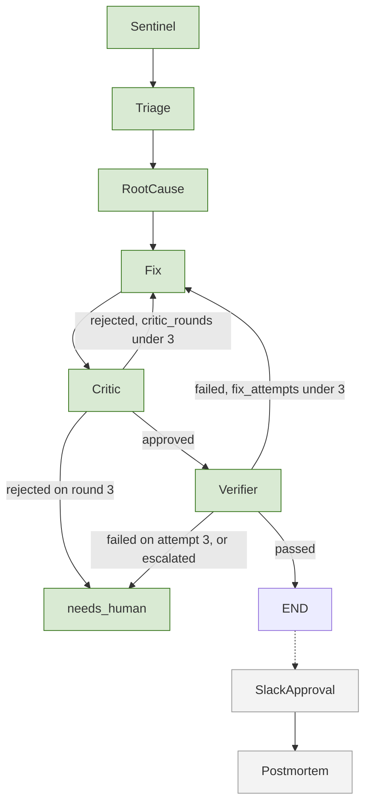

# MERIDIAN

MERIDIAN is being built to detect data-quality failures, explain them, propose a fix, verify that fix against the failing data, and ask a human in Slack before anything merges. The path is a fixed LangGraph state machine. The goal is to shorten the time from incident to a verified, approved fix.

This repository has the Phase 0 contracts, the Phase 1 data contracts and injector, the Phase 2 Sentinel → Triage graph, and the Phase 3 root-cause agent. Phase 4 is the Fix → Critic → Verifier loop. Slack and the postmortem are not built. Unit tests do not call a model or Slack.

## Target agent graph

Sentinel through the verifier are implemented. Slack approval and the postmortem are planned. A passing verifier ends the branch.



| Node | Planned role |
| --- | --- |
| Sentinel | Run pandera contracts over partitions on Ray and emit an `Incident`. |
| Triage | Claude assigns severity and blast radius. |
| RootCause | Claude, with MCP tools, writes a `Hypothesis` and evidence. |
| Fix | Claude writes a `Patch`: `DATA_REPAIR`, `QUARANTINE`, `RERUN_UPSTREAM`, or `ESCALATE`. |
| Critic | Grok reviews the patch. Objections are typed. Three rejections escalate. |
| Verifier | Ray replays the partition in a sandbox. Pass/fail does not use a label. |
| SlackApproval | LangGraph interrupt. A human approves, rejects, or the request times out. |
| Postmortem | Write the incident report. |

## MCP tools

Root cause may call these. Each response is a Pydantic model with a stable `ref`. The tools only read.

| Tool | Returns | Ref |
| --- | --- | --- |
| `get_upstream` | Datasets that feed this one | `lineage:upstream:<dataset>` |
| `get_downstream` | Datasets this one feeds | `lineage:downstream:<dataset>` |
| `get_contract` | Pandera column names and named checks | `contract:<dataset>` |
| `describe_partition` | Dtypes and null rates | `partition:<path>`, `column:<path>:<column>` |
| `compare_to_reference` | PSI and null rate per profiled column | `psi:<dataset>`, `psi:<dataset>:<column>` |
| `sample_failures` | Up to 20 stored sample rows | `sample:<incident_id>` |
| `list_events` | Change events, with optional filters | `events:<dataset>`, `event:<id>` |
| `get_event` | One change event | `event:<id>` |

A citation survives only when that ref came back from a tool in the same case. `MERIDIAN_ROOTCAUSE_MAX_TOOL_CALLS` defaults to 8.

Loop limits, enforced on each `IncidentCase`: a critic rejection under round 3 returns to Fix. Round 3 escalates. A failed verification under 3 Fix executions returns to Fix. The third failure escalates. `fix_attempts` counts Fix executions, so the cap is 3.

## Phases

| Phase | Scope | Status |
| --- | --- | --- |
| 0 | Repository, ADRs, Pydantic contracts, CI | done |
| 1 | Pandera contracts and an incident injector | done |
| 2 | Graph skeleton: Sentinel to Triage | done |
| 3 | RootCause agent with MCP tools | done |
| 4 | Fix, Critic, and Verifier loop on Ray | in progress |
| 5 | Slack approval gate and Postmortem | planned |
| 6 | MERIDIAN-Bench harness and published results | planned |
| 7 | OpenTelemetry, cost tracking, Docker Compose demo | planned |

## What is in this tree

- `src/meridian/contracts/` — frozen Pydantic models. A run is `MeridianState`: partitions, `llm_calls`, `tool_calls`, and one `IncidentCase` per incident.
- `src/meridian/pipeline/` — seeded generators for the three fleet datasets, plus `lineage.yaml`.
- `src/meridian/quality/` — pandera models, PSI, the freshness SLA, and `evaluate`, which returns `Incident` records.
- `src/meridian/agents/` — Sentinel on Ray, Triage, the bounded root-cause tool loop, Fix, Critic, and the deterministic Verifier.
- `src/meridian/sandbox/` — AST gate and the Ray task that runs a remediation.
- `src/meridian/mcp_servers/` — read-only lineage, data, and history tools.
- `src/meridian/graph/` — one branch per incident: triage, root cause, then Fix, Critic, and Verifier inside the caps above. The checkpointer is still SQLite.
- `src/meridian/prompts/` — `triage.v1.md`, `root_cause.v1.md`, `fix.v1.md`, and `critic.v1.md`.
- `src/meridian/bench/` — `score_root_cause.py` and `score_fix.py`. Both are unit-tested. No accuracy is published from them.
- `src/meridian/run.py` — `python -m meridian.run`. `--fake-llm` is the default. `--live` calls Claude for triage, root cause, and fix, and Grok for the critic.
- `src/meridian/injector/` — one injector per fault type, the seeded `events.jsonl` log, and the `python -m meridian.injector` CLI.
- `src/meridian/config.py` — settings loaded from the environment and `.env`. Missing keys do not crash import. `Settings.require_anthropic()`, `Settings.require_xai()`, and `Settings.require_slack()` raise when a caller actually needs those credentials. `--live` asks for Anthropic, then the four model names, then xAI.
- `schemas/` — JSON Schema generated from the contracts.
- `docs/adr/` — ADR-001 through ADR-022.
- `.github/workflows/ci.yml` — the checks below.

Generated Parquet under `data/` is gitignored.

## Fault catalog

| Fault | How it is injected | Check that catches it |
| --- | --- | --- |
| `SCHEMA_DRIFT` | Intensity below 0.1 retypes the first key column, below 0.5 renames it, and 0.5 and above drops it. | Column presence and dtype (`column_in_dataframe`, `column_in_schema`, `wrong_dtype`). |
| `NULL_EXPLOSION` | Nulls that fraction of a non-nullable, non-key column. | `not_nullable`. |
| `UNIT_MISMATCH` | Multiplies that fraction of rows by 3.6 on m/s columns, or by 1000 on kilometres. | Range checks, and `speed_matches_distance` on trips. |
| `DUPLICATE_KEYS` | Appends copies of that fraction of rows, repeating the primary key. | `multiple_fields_uniqueness`. |
| `LATE_PARTITION` | Leaves the frame unchanged and moves arrival past the 2 hour SLA. The offset grows with intensity and is always late. | `partition_arrival_sla` on `PartitionMetadata`. |
| `DISTRIBUTION_SHIFT` | Power-warps the PSI column inside its generating range (`u ** (1 + 100 * intensity)`). On trips, distance is recomputed so the speed identity still holds. Legal ranges still hold. | PSI against a quantile profile fit on a separate clean partition. Threshold 0.2. |

## Quickstart

Requires Python 3.11+ and [uv](https://docs.astral.sh/uv/).

```bash
uv sync
uv run ruff check .
uv run ruff format --check .
uv run mypy --strict src
uv run pytest --cov=src/meridian --cov-fail-under=95 -q -m "not live"
uv run python scripts/export_schemas.py && test -z "$(git status --porcelain schemas/)"
uv run python -m meridian.run --dataset vehicle_telemetry --fault SCHEMA_DRIFT --intensity 0.3 --seed 42 --fake-llm
uv run python -m meridian.run --dataset fleet_daily_kpi --fault NULL_EXPLOSION --intensity 0.0 --seed 7 --fake-llm
```

Copy `.env.example` to `.env` only when a later phase needs credentials. Phase 0 tests do not call external services.

## License

Apache-2.0. Copyright 2026 MERIDIAN contributors.
